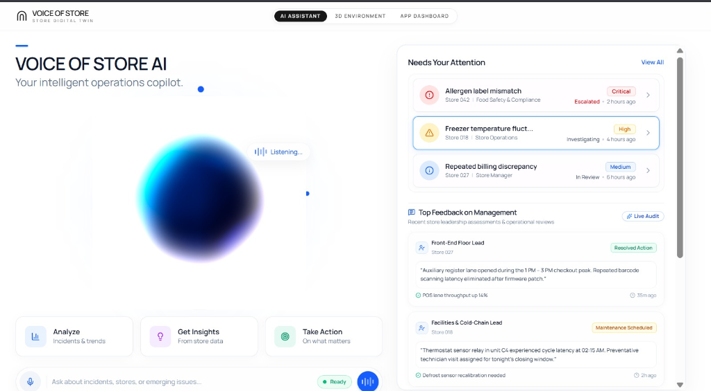
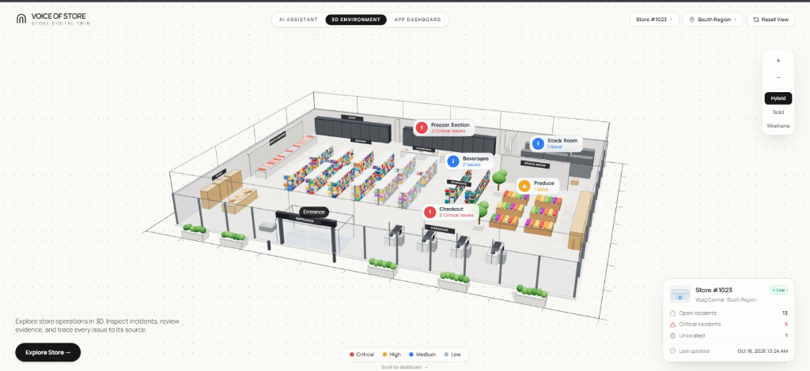
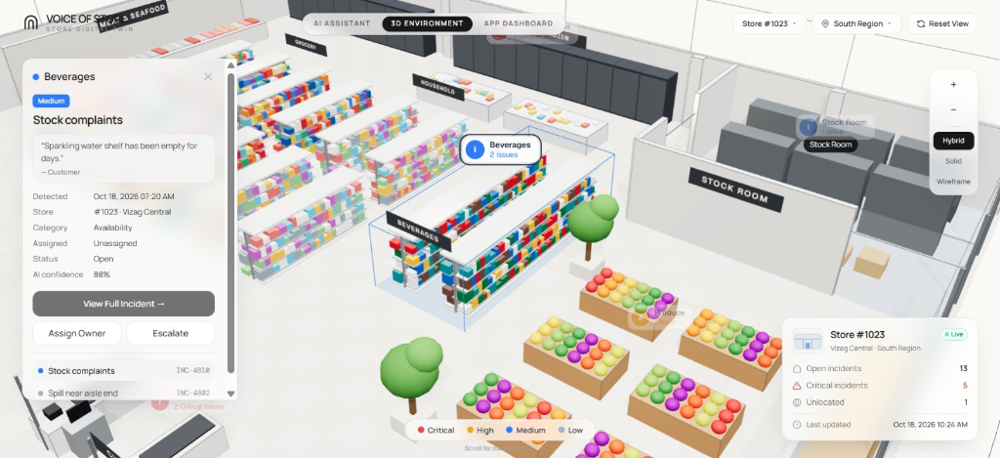
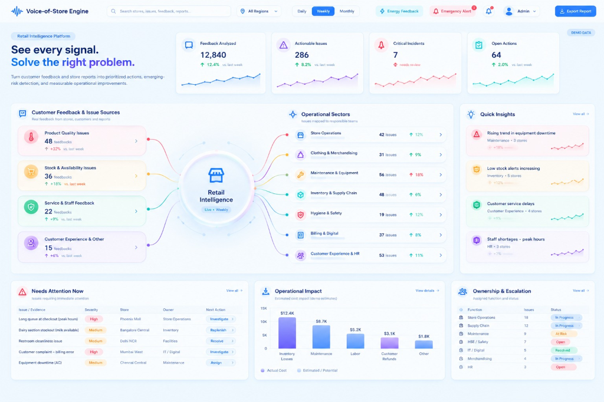

#  Voice of Store (VoS)
### AI-Powered Retail Digital Twin & Conversational Operations Copilot
**AI Frontier Challenge 2026 — Round 1 Submission**  
*Track: Enterprise AI & Autonomous Retail Operations*

[-080A0F?style=for-the-badge&logoColor=white)](https://github.com/Karthik-16-tech/Opsight)
[](https://ai.google.dev/)
[](https://threejs.org/)
[](https://vitejs.dev/)
[](https://fastapi.tiangolo.com/)

---

<p align="center">
  <b>Voice of Store (VoS) bridges the critical divide between customer voice, store floor reality, and executive action.</b><br/>
  By fusing real-time multimodal voice AI, an interactive 3D WebGL store digital twin, and automated sector dispatch, Voice of Store transforms thousands of chaotic daily customer complaints, employee voice notes, and IoT sensor alerts into surgical, localized operational improvements.
</p>

<p align="center">
  <a href="#-executive-summary">Executive Summary</a> •
  <a href="#-visual-showcase--platform-tour">Visual Showcase</a> •
  <a href="#-key-challenges-addressed">Key Challenges</a> •
  <a href="#-unique-selling-proposition-usp">Unique Selling Proposition</a> •
  <a href="#-system-architecture">System Architecture</a> •
  <a href="#-sector-wise-governance--reports">Sector Reports</a> •
  <a href="#-quick-start--local-development">Quick Start</a> •
  <a href="#-competition-pitch-deck">Pitch Deck</a>
</p>

---

## 📌 Executive Summary

Modern hypermarkets and retail chains process millions of customer interactions each week. However, **90% of in-store customer feedback and frontline staff voice notes are lost, fragmented, or delayed** across disconnected suggestion boxes, cashier rants, and siloed internal email chains.

When a refrigeration unit drifts above temperature, an allergen label is misprinted on bakery racks, or sparkling water stock is depleted during peak checkout hours, store leadership typically discovers the issue hours or days later—after margin loss, inventory waste, and brand damage have already occurred.

**Voice of Store (VoS)** introduces a continuous, AI-driven closed-loop platform:
1. **Listens**: Captures multi-source feedback via conversational speech, customer reviews, barcode scanners, and IoT sensor streams.
2. **Localizes in 3D**: Pins every incident and feedback cluster to its exact physical coordinates in a WebGL 3D store digital twin.
3. **Dispatches & Solves**: Routes prioritized action items directly to responsible operational sectors (Store Ops, Facilities & Cold Chain, Merchandising, Supply Chain, Hygiene & HSE, Billing/IT, and HR).
4. **Governs**: Generates sector-specific audit reports and 1-click executive PDF dossiers with complete operational impact cost analytics.

---

## 📸 Visual Showcase & Platform Tour

### 1. Voice of Store AI Copilot (`/dashboard`)
> **Conversational operations copilot with dynamic liquid-glass visualization, real-time voice speech recognition, urgent operational triage, and live store leadership feedback reviews.**

<div align="center">
  
</div>

- **Liquid Glass Voice Orb**: Interactive visualizer providing voice-to-text intelligence powered by Gemini Flash for concise, punchy 2–3 sentence operational answers.
- **Urgent Incident Triage ("Needs Your Attention")**: Prioritizes urgent items in real-time with severity chips:
  - *Allergen label mismatch* (Critical — Store 042 / Food Safety & Compliance)
  - *Freezer temperature fluctuation* (High — Store 018 / Facilities & Cold Chain)
  - *Repeated billing discrepancy* (Medium — Store 027 / Store Manager)
- **Top Feedback on Management**: Live audit trail of frontline employee assessments (Floor Leads, Cold-Chain Leads) with verified resolution benchmarks (e.g., POS lane throughput +14%).
- **Instant Cognitive Action Cards**: 1-click analysis shortcuts for *Analyze Incidents & Trends*, *Get Insights*, and *Take Action*.

---

### 2. 3D WebGL Store Digital Twin (`/environment`)
> **Hardware-accelerated 3D spatial retail twin rendered via Three.js. Provides isometric store bird's-eye visibility with dynamic real-time incident pins.**

<div align="center">
  
</div>

- **Architectural Store Layout**: Fully rendered spatial model of **Store #1023 (Vizag Central)**, including Entrance, Checkout Lanes, Produce Gondolas, Bakery, Grocery Aisles, Freezer Cold-Chain Wall, Beverages Section, and Backroom Stock Storage.
- **Severity-Coded 3D Spatial Pins**:
  - 🔴 **Critical (5 Incidents)**: Immediate action required (Freezer temp excursion, Checkout queue deadlock).
  - 🟡 **High**: Elevated operational anomalies (Stockroom staging delays).
  - 🔵 **Medium**: Minor replenishment needs or customer inquiries (Beverage empty shelf reports).
  - 🟢 **Low**: General observations and aesthetic feedback.
- **Render Modes & Viewport Controls**: Switch seamlessly between **Hybrid**, **Solid**, and **Wireframe** architectural modes with interactive orbital pan, zoom, and camera reset.
- **Store Telemetry Card**: Live HUD tracking open incidents (13), critical issues (5), unlocated anomalies (1), and timestamped sync status.

---

### 3. Aisle-Level 3D Incident Inspection & Direct Escalation
> **Spatial deep-dive modal enabling floor managers to click any store aisle pin, inspect raw customer feedback quotes, verify AI confidence, and execute owner assignment.**

<div align="center">
  
</div>

- **Direct Voice of Customer Quote**: Surfaces verbatim feedback (e.g., *"Sparkling water shelf has been empty for days. — Customer"*).
- **Incident Metadata Breakdown**: Displays detection timestamp, store branch ID, root category (*Availability*), assigned status, and AI confidence rating (**88% confidence**).
- **In-Situ Operational Actions**:
  - `View Full Incident`: Opens comprehensive historical ticket audit.
  - `Assign Owner`: Dispatches automated alert to the department team lead.
  - `Escalate`: Escalates directly to Regional Operations Management.
- **Multi-Incident Aisle Carousel**: Switch between multiple co-located incidents (e.g., *Stock complaints* vs. *Spill near aisle end*).

---

### 4. Retail Intelligence Engine & Signal Flow Dashboard (`/app-dashboard`)
> **Macro-level command center displaying end-to-end signal routing from unstructured feedback sources into responsible operational sectors, financial impact metrics, and escalation matrices.**

<div align="center">
  
</div>

- **End-to-End Signal Routing Flow**:
  - **4 Ingestion Sources**: Product Quality Issues (48 feedbacks), Stock & Availability (36 feedbacks), Service & Staff (22 feedbacks), Customer Experience & Other (15 feedbacks).
  - **Central Retail Intelligence Nucleus**: Real-time classification, sentiment weighting, and priority assignment.
  - **7 Operational Sectors**: Dispatches clean work streams to Store Operations, Clothing & Merchandising, Maintenance & Equipment, Inventory & Supply Chain, Hygiene & Safety, Billing & Digital, and HR.
- **Executive KPI Stream**:
  - **12,840** Feedbacks Analyzed (↑ 12.4% vs last week)
  - **286** Actionable Issues Identified (↑ 8.2%)
  - **7** Critical Incidents under active triage
  - **64** Open Remediation Actions
- **Operational Impact & Cost Analysis**: Real-time financial estimation of operational loss ($12.4K Inventory Losses, $8.7K Equipment Downtime, $5.2K Overtime Labor, $3.1K Customer Refunds).
- **Ownership & Escalation Status Matrix**: Live departmental accountability dashboard tracking team caseloads and completion rates (*In Progress*, *At Risk*, *Open*, *Resolved*).

---

## 🎯 Key Challenges Addressed

```
┌─────────────────────────────────────────────────────────────────────────────────────────┐
│                          THE RETAIL OPERATIONAL TRIPLE BOTTLENECK                       │
├────────────────────────────┬────────────────────────────┬───────────────────────────────┤
│ 1. Feedback Tsunami        │ 2. Spatial Blind Spots     │ 3. Departmental Silos         │
│ Over 12,000 weekly signals │ Traditional dashboards show│ Store managers receive generic│
│ arrive as unstructured     │ bar charts, but staff don't│ complaints ("produce looks bad│
│ noise across reviews, POS, │ know WHICH aisle or cooler │ but cannot isolate whether it'│
│ and verbal complaints.     │ is malfunctioning in 3D.   │ supply chain, cooler, or staff│
└────────────────────────────┴────────────────────────────┴───────────────────────────────┘
```

1. **Information Overload to Actionable Intelligence**: Voice of Store filters out trivial noise and normalizes freeform customer feedback into structured, deduplicated operational tickets with AI confidence scoring.
2. **Physical Contextualization via 3D Digital Twin**: By binding complaints to physical 3D store coordinates, maintenance crews and floor associates walk directly to the point of failure without hunting across square footage.
3. **Closed-Loop Resolution & Executive Governance**: Prevents issues from slipping through cracks by assigning clear ownership, setting SLA thresholds, and notifying department leadership through sector-wise reports.

---

## 💡 Unique Selling Proposition (USP)

| Traditional Retail APM / ERP | Voice of Store (VoS) |
| :--- | :--- |
| ❌ Rigid forms requiring manual staff entry | ✅ **Conversational Voice AI**: Speak naturally to inquire, triage, or report |
| ❌ Abstract 2D spreadsheets and tables | ✅ **Interactive 3D Digital Twin**: Spatial visual awareness in WebGL Three.js |
| ❌ Delayed batch processing (days/weeks) | ✅ **Real-Time Signal Routing**: From customer quote to sector dispatch in <5 seconds |
| ❌ Generic store-wide alerts without context | ✅ **Granular Aisle Localization**: Pinpoints specific shelf, freezer unit, or register |
| ❌ Fragmented departmental visibility | ✅ **Sector-Wise Governance & 1-Click Executive PDF Dossiers** |

---

## 🏗️ System Architecture

```
┌────────────────────────────────────────────────────────────────────────────────────────────────┐
│                                  VOICE OF STORE ARCHITECTURE                                   │
├────────────────────────────────────────────────────────────────────────────────────────────────┤
│                                                                                                │
│  [ TIER 1: MULTIMODAL INGESTION PLANE ]                                                        │
│  • Customer Reviews & In-Store Feedback Portals                                                │
│  • Frontline Employee Voice Notes & Barcode Scanner Feeds                                      │
│  • Refrigeration, HVAC, & IoT Smart Sensor Telemetry                                           │
│                                                                                                │
│                                          │  Continuous Ingestion Streams                       │
│                                          ▼                                                     │
│  [ TIER 2: GEMINI 2.5 FLASH REASONING & DISPATCH CORE ]                                        │
│  • FastAPI / Python Intelligence Engine                                                        │
│  • Sentiment & Priority Vector Classifier (Urgency, Severity, Category)                         │
│  • Spatial Coordinate Mapper (Binds feedback to 3D store layout coordinates)                   │
│  • Automated Sector Router (Store Ops, Cold Chain, Supply Chain, Hygiene, Billing)             │
│                                                                                                │
│                     │                                                 │                        │
│                     ▼                                                 ▼                        │
│  [ TIER 3: SPATIAL 3D DIGITAL TWIN ]             [ TIER 4: EXECUTIVE GOVERNANCE & REPORTS ]    │
│  • Three.js WebGL Store Twin (Isometric)         • Full-White Executive Mega Report Generator  │
│  • Aisle & Unit Pin Overlays (Critical/High)     • Sector-Specific Operational PDF Exports     │
│  • Liquid-Glass Voice Copilot HUD                • Estimated Financial Impact Analytics        │
│  • OrbitControls & Multi-Layer Inspect Drawers   • Role-Based Escalation Matrix                │
│                                                                                                │
└────────────────────────────────────────────────────────────────────────────────────────────────┘
```

---

## 📑 Sector-Wise Governance & Reports

Voice of Store features enterprise-grade report generation tools tailored for corporate executives and branch directors:

### 1. Dedicated Sector Reports (`/admin`)
Store managers and regional inspectors can preview and export standalone, sector-specific dossiers with 1 click:
- **Store Operations Report**: Front-end congestion, checkout throughput, peak hour staffing.
- **Food Safety & Cold-Chain Report**: Cooler telemetry, temperature logs, allergen audits.
- **Maintenance & Facilities Report**: HVAC uptime, equipment failure logs, work order schedules.
- **Inventory & Supply Chain Report**: Out-of-stock indices, backroom replenishment delays.
- **Hygiene & HSE Compliance Report**: Sanitation audit scores, spill response timings.
- **Billing & Digital Systems Report**: POS scanner latency, payment gateway timeouts.

### 2. Full-White Executive Mega Report (`/app-dashboard`)
Accessible directly from the top navigation bar via **"Export Report"**:
- Renders an ultra-clean, full-white print-ready PDF document formatted for C-suite presentations.
- Includes executive metric summaries, financial impact estimates, departmental matrices, and timestamped audit logs.

---

## 🛠️ Technology Stack

- **Frontend Framework**: [React 19](https://react.dev/), [TypeScript](https://www.typescriptlang.org/), [Vite](https://vitejs.dev/)
- **Routing & State**: [TanStack Router](https://tanstack.com/router)
- **3D Graphics & Shaders**: [Three.js](https://threejs.org/), [React Three Fiber](https://r3f.docs.pmnd.rs/), [Drei](https://github.com/pmndrs/drei), Spline
- **Styling & Motion**: Custom Glassmorphism CSS, Tailwind CSS, Lucide Icons
- **AI Intelligence**: Google Gemini 2.5 Flash API via `@google/genai`
- **Voice Pipeline**: Web Speech Recognition API & Web Audio API
- **Backend Service**: FastAPI (Python 3.11+), Uvicorn, WebSockets
- **Document Generation**: HTML5 Print Engine & Clean White PDF Styler

---

## 🚀 Quick Start & Local Development

### Prerequisites
- Node.js (v18+) or [Bun](https://bun.sh)
- Python 3.10+
- (Optional) Gemini API Key

### 1. Clone the Repository
```bash
git clone https://github.com/Karthik-16-tech/Opsight.git
cd Opsight
```

### 2. Configure Environment Variables
Copy or create `.env` in the repository root:
```env
VITE_GEMINI_API_KEY="your-gemini-api-key"
VITE_FASTAPI_BACKEND_URL="http://localhost:8000"
```

### 3. Run the Frontend
```bash
# Install dependencies
npm install

# Start Vite dev server on port 3000
npm run dev
```
Open **`http://localhost:3000`** in your browser.

### 4. (Optional) Run the FastAPI Backend
```bash
cd backend
python -m venv venv
# Windows:
.\venv\Scripts\activate
# macOS/Linux:
source venv/bin/activate

pip install -r requirements.txt   # or: pip install fastapi uvicorn google-genai
python main.py
```

---

## 🗺️ Key Application Routes

| Route | View Name | Purpose |
| :--- | :--- | :--- |
| **`/`** | **Landing Showcase** | Hero introduction to Voice of Store with interactive feature demos. |
| **`/dashboard`** | **AI Assistant & Copilot** | Liquid glass orb, speech-to-text chat, attention triage, and management feedback. |
| **`/environment`** | **3D Store Digital Twin** | Full Three.js WebGL store twin with interactive 3D pins and aisle inspection drawers. |
| **`/app-dashboard`** | **Retail Intelligence Platform** | Signal flow routing, KPI metric dials, financial impact charts, and Mega Report export. |
| **`/admin`** | **Admin Sector Governance** | Sector-wise management portal with individual departmental export cards. |

---

## 🏆 Competition Pitch Deck

The official 7-slide luxury black competition pitch deck is included directly in this repository:
- **File Location**: [`public/Voice_of_Store_AI_Frontier_Pitch_Deck.pptx`](public/Voice_of_Store_AI_Frontier_Pitch_Deck.pptx)
- **Deck Contents**:
  1. *Executive Title & Identity* (VOX / Retail Intelligence)
  2. *The Retail Operational Crisis* (Telemetry Tsunami & Silos)
  3. *The Voice of Store Solution* (Listen, Localize, Dispatch, Govern)
  4. *Platform Showcase & 3D Twin* (Annotated UI Breakdown)
  5. *Deep-Dive Architecture & ML Vector Engine* (Closed Loop Pipeline)
  6. *Competitive Advantage & Business Impact* (85% Faster Resolution)
  7. *Vision, Roadmap & Team* (Autonomous Retail Future)

---

<div align="center">
  <b>Voice of Store (VoS) — Built for the AI Frontier Challenge 2026</b><br/>
  <i>Empowering retail operators to see every signal, pinpoint every anomaly in 3D, and solve the right problems instantly.</i>
</div>
